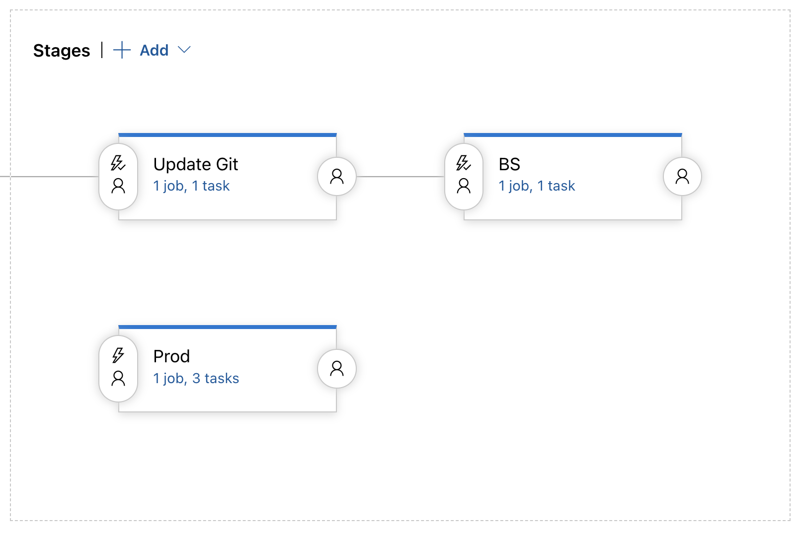
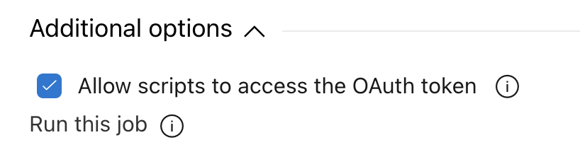
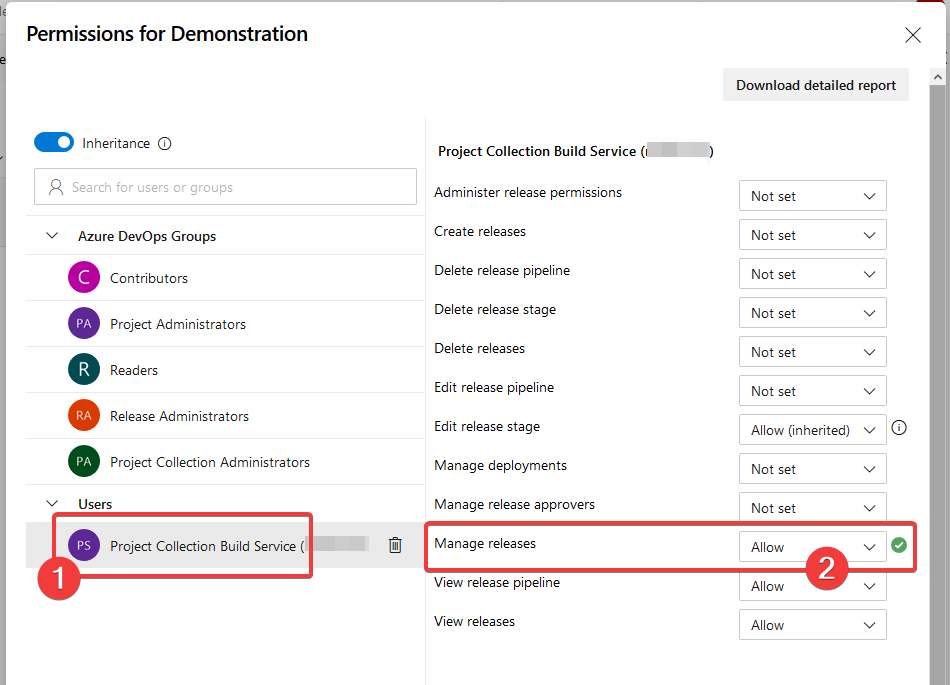

# Azure DevOps for APIM
### A set of scripts to use in Azure DevOps for Azure API Management CI/CD

Please remember to use APIM named values to distinguish the endpoints or other variables between the PRE, BS, and PROD environments.

The following variables should be created in the release pipeline and two of them should be enabled as settable variables at release time:

- ReleaseCommit ✅ 
- RollBackCommit ✅    
- ResourceGroupPre
- ResourceGroupBS
- ResourceGroupProd
- ServiceNamePre  
- ServiceNameBS
- ServiceNameProd

Enter the values as plain text, without quotes: the scripts quote them.

Paste each script as the inline script of an Azure PowerShell task in its stage, then edit the placeholders at the top of each script: `$org_name`, `$proj_name` and `$repo_name` (the Azure Repos organization, project and repository used for the clone and push URLs). In `UpdateGitStage.ps1`, also replace `artifact_alias` in `$(Release.Artifacts.artifact_alias.SourceVersion)` with your artifact's alias.

Allow scripts to access the OAuth token should be activated in the agents

And change the permissions of Project Collection Build Service to Allow - Manage releases:

So in the end, the first stage will get the current status of the APIM-PRE and update the Devops Repo, the second stage will get the Devops Repo and updates the APIM-BS and the last one will get the Devops Repo and updates the APIM-PROD.

